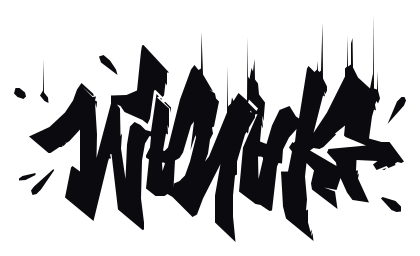
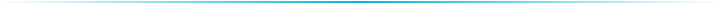

  <picture>
    <source media="(prefers-color-scheme: dark)" srcset="manak-wordmark-dark.svg">
    
  </picture>

Founder of OmniRise. Building:

<samp><a href="https://github.com/OmniRise/LinkBreeze">LinkBreeze</a> ........ </samp> 
<samp><a href="https://github.com/OmniRise/OmniBroom">OmniBroom</a> ........... </samp> 
<samp><a href="https://github.com/OmniRise/OmniToys">OmniToys</a> ............ </samp> 
<samp><a href="https://github.com/OmniRise/OmniFlow">OmniFlow</a> ............ </samp>

  <picture>
    <source media="(prefers-color-scheme: dark)" srcset="manak-divider.svg">
    
  </picture>

<a href="https://omnirise.dev" title="omnirise.dev"><picture>
    <source media="(prefers-color-scheme: dark)" srcset="https://api.iconify.design/ph/globe.svg?color=%2307b6d5&amp;width=26&amp;height=26">
    </picture></a>&nbsp;&nbsp;&nbsp;<a href="mailto:manak@omnirise.dev" title="manak@omnirise.dev"><picture>
    <source media="(prefers-color-scheme: dark)" srcset="https://api.iconify.design/ph/envelope-simple.svg?color=%2307b6d5&amp;width=26&amp;height=26">
    </picture></a>&nbsp;&nbsp;&nbsp;<a href="https://x.com/OmniRise00" title="@OmniRise00"><picture>
    <source media="(prefers-color-scheme: dark)" srcset="https://api.iconify.design/ph/x-logo.svg?color=%2307b6d5&amp;width=26&amp;height=26">
    </picture></a>&nbsp;&nbsp;&nbsp;<a href="https://discord.com/users/332326479155298316" title="Manak on Discord"><picture>
    <source media="(prefers-color-scheme: dark)" srcset="https://api.iconify.design/ph/discord-logo.svg?color=%2307b6d5&amp;width=26&amp;height=26">
    </picture></a>

